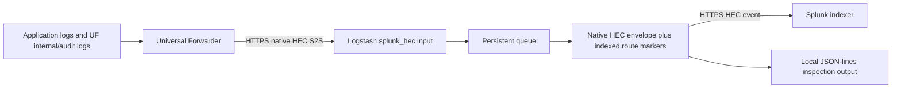

# Existing Docker test lab

This folder documents the **already running** UF → HTTPS HEC S2S → Logstash →
HTTPS HEC → Splunk indexer test environment. It contains its configuration
snapshots, a Compose reference, equivalent bootstrap source, and scripts that
inspect and validate the existing containers without redeploying them.

**No new environment, plugin gem or image was built for this documentation.**
The current containers were created with individual Docker commands, not Compose.
The Compose file has been rendered/checked as a reference; a fresh Compose launch
has **not** been qualified. Do not run `docker compose up` or `down` to try to
adopt the existing containers. Their names would collide, and Compose does not
own their lifecycle.

## 1. What is running



The folder is named `test-lab`. Existing container/network names are retained
below to describe the actual deployment rather than silently renaming it.

| Role | Existing container | Host access |
|---|---|---|
| UF 10.6.1.1 | `hec-demo-uf` | No published port |
| Logstash 9.5.5 / Java 21 | `hec-demo-logstash` | HTTPS HEC: `https://localhost:18888` |
| Splunk 10.6.1.1 indexer | `hec-demo-indexer` | Web: `http://localhost:18000`; HTTPS HEC: `19088`; management API: `19089` |

All published ports bind to `127.0.0.1`. The existing Docker network is
`hec-demo-chain`. Inside that network the UF sends to
`https://hec-demo-logstash:8088`, and Logstash sends to
`https://hec-demo-indexer:8088/services/collector/event`.
The UF has no configured direct indexer destination.

Image identities are pinned in [versions.properties](../../versions.properties).
The Compose environment exported below obtains the actual running image names,
host ports and external volume identities from Docker inspection.

## 2. What is in this folder

```text
docker/test-lab/
  compose.yml                    Existing topology / equivalent startup reference
  .env.example                   Placeholders only; never the live credentials
  config/
    uf/                          Six forwarder app files
    logstash/                    Pipeline, settings and token-policy template
    indexer/                     Six indexer app files, including audit/route rules
  scripts/
    inspect_lab.py               Read-only topology inspection; optional env export
    validate.py                  Read-only searches and Logstash raw-sample comparison
    lab.py                       Shared inspection/credential/report helpers
    bootstrap/                   Container-only equivalent bootstrap sources
  reports/                       Ignored, locally generated validation reports
  .env.local                     Ignored, locally exported credentials and paths
```

The [full configuration guide](../../docs/uf-logstash-splunk-reference.md)
explains the settings inline. The actual files are also stored here so users can
inspect them together. They are snapshots/templates; editing this checkout does
not update the running containers automatically.

### Forwarder app: `/opt/splunkforwarder/etc/apps/hec_chain_demo/local/`

| File | Purpose |
|---|---|
| [outputs.conf](config/uf/outputs.conf) | Native `[httpout]` forwarding to Logstash, TLS trust/name checks, disabled index filtering and no local indexing |
| [inputs.conf](config/uf/inputs.conf) | UF own-log collection, explicit `_audit` monitors and the text/JSON application monitors |
| [props.conf](config/uf/props.conf) | Sender-side line handling and JSON indexed extraction/timestamps |
| [server.conf](config/uf/server.conf) | Trust Logstash's public certificate; disable unused KV Store |
| [limits.conf](config/uf/limits.conf) | Remove the demo UF's throughput cap; not a throughput benchmark |
| [web.conf](config/uf/web.conf) | Do not start a UF Web UI |

`forwardedindex.filter.disable = true` is under `[tcpout]` because that is where
the UF's index filter is configured; it does not add a TCP destination. The
actual transport is `[httpout]`, with only the Logstash URI.

The parent log monitor routes ordinary UF logs to `_internal` and excludes audit
filenames. Explicit audit monitors route those to `_audit`. More-specific vendor
inputs can still select native indexes such as `_configtracker`. “All indexes”
means all events emitted by configured inputs, not every file on the filesystem.

### Logstash configuration

| File | Container path / purpose |
|---|---|
| [pipeline.conf](config/logstash/pipeline.conf) | `/run-hec/config/pipeline.conf`: receive, queue, preserve the envelope, add route markers and send HTTPS HEC |
| [logstash.yml](config/logstash/logstash.yml) | `/run-hec/config/logstash.yml`: persistent queue and deliberately small test pipeline |
| [pipelines.yml](config/logstash/pipelines.yml) | `/run-hec/config/pipelines.yml`: load `uf_hec_s2s_to_splunk` |
| [hec-inputs.conf](config/logstash/hec-inputs.conf) | Template for `/demo/hec-inputs.conf`: UF → Logstash token and fallback index |

The input accepts HTTPS on port 8088. Its 8 MiB logical-event cap and 512 MiB
allocation-accounting budget accommodate the observed large UF internal records.
They are explicit test settings, not plugin defaults or a JVM heap-size guarantee.

The filter copies `event`, `time`, `host`, `source`, `sourcetype`, `index` and
existing `fields` into the outbound HEC envelope. It adds two HEC **indexed**
fields:

```text
ingest_via = logstash
logstash_pipeline = uf_hec_s2s_to_splunk
```

These are set by Logstash, not by the UF or the indexer token. They are searchable
as `ingest_via` and `logstash_pipeline` in Splunk; the original `_raw` is unchanged.
Those two names are reserved in this test pipeline and overwrite producer values
with the same exact names. Other indexed values and the original index survive.

The root `demo_path` and selected `s2s_metadata` remain in the local inspection
output only. They are not automatically part of the outbound HEC envelope.
Simply adding a root Logstash `tags` field would not pass this envelope whitelist;
that is why the route proof uses HEC indexed fields.

The current pipeline uses `pipeline.batch.size: 100` and one worker. That is up
to 100 events per pipeline batch, not 100 HEC envelopes per HTTP request. The
HTTP output's `format => "message"` still sends one event per request.
This setting was changed from 1 to 100 on 2026-10-31 by restarting only the
existing Logstash container; its startup log confirmed batch size 100 and the
HTTPS health check passed. No replacement environment was built for that tuning.

### Indexer app: `/opt/splunk/etc/apps/hec_chain_demo/local/`

| File | Purpose |
|---|---|
| [inputs.conf](config/indexer/inputs.conf) | HTTPS HEC, destination token and fallback index/sourcetype; no index allowlist |
| [props.conf](config/indexer/props.conf) | Required exact-source override of the default audit-file discard rule |
| [fields.conf](config/indexer/fields.conf) | Declare both route markers as indexed search fields |
| [indexes.conf](config/indexer/indexes.conf) | Define the `hec_demo` application index |
| [web.conf](config/indexer/web.conf) | Enable the loopback-published local Web UI |
| [server.conf](config/indexer/server.conf) | Disable KV Store, which is not needed for the tested ingestion/search path |

The built-in `_internal`, `_audit` and `_configtracker` indexes already exist.
Other destination indexes must exist before forwarding to them. An unrestricted
HEC token does not create indexes automatically.

### Why the audit override matters

In this Splunk distribution, the default source rules for monitored
`.../var/log/splunk/audit.log` and `audit_v2.log` apply
`TRANSFORMS = send_to_nullqueue`. Thus an audit event can arrive in Logstash,
receive HEC acceptance at the indexer, and still be discarded during parsing.

The indexer `props.conf` clears that transform for these exact UF source paths:

```ini
[source::/opt/splunkforwarder/var/log/splunk/audit.log]
TRANSFORMS =
sourcetype = audittrail
SHOULD_LINEMERGE = false
```

The matching `audit_v2.log` stanza is in the same file. If the UF installation
path changes, match the actual incoming `source` instead of copying the old path.

The audit monitor CRC salt was changed once to reread the previously discarded
audit backlog. Keep it stable; repeatedly changing it can reread files and create
duplicates. `<SOURCE>` in that salt is literal Splunk syntax, not a token placeholder.

## 3. Credentials, certificates and persistence

The existing state directory is `../demo-hec-chain/` beside the plugin repository;
its actual location can be discovered from the indexer's `/demo` bind mount.
It remains outside Git and is **not** moved by this documentation.

`connection.json` there is a mode-0600 local file:

| Key | Meaning |
|---|---|
| `username`, `password`, `url` | Existing indexer's Web/API login; user `admin`, Web port 18000 |
| `input_token` | Match UF `httpEventCollectorToken` to Logstash's token-policy `token` |
| `indexer_hec_token` | Match indexer HEC `token` to Logstash's `SPLUNK_HEC_TOKEN` environment variable |
| `run_id` | Existing lab ownership/sample-generation identity |

Passwords, tokens and private keys are not included here. The INI files contain
explicit placeholders; Splunk does not expand those placeholders automatically.
The packaged bootstrap sources substitute them from the appropriate environment
variable when explicitly used inside a container. The current running containers
continue using their original external bootstrap scripts.

Certificates and data live in the existing state/volumes:

| Location | Purpose |
|---|---|
| `logstash/state/identity/` | Persisted Logstash input TLS identity and public `server.crt` |
| UF app `trusted-logstash.crt` | Copy of Logstash's public certificate; trust and hostname checks are enabled |
| `tls/indexer.pem` | Existing indexer certificate plus private key; SANs include `hec-demo-indexer` and `localhost` |
| `tls/indexer.crt` | Public indexer certificate trusted by the Logstash HTTP output |
| `logstash/data/` | Persistent queue/data, 16 MiB pages and 256 MiB queue cap |
| `logstash/received.ndjson` | Decoded/filter-tagged local inspection output |
| Indexer and UF Docker `etc`/`var` volumes | Splunk configuration, credentials, fishbucket/index state |

Both ingestion hops verify certificate trust and hostname. The local indexer
certificate has a 30-day lifetime. The separate management API still uses its
vendor-generated certificate: the validation script disables verification only
for that loopback diagnostic request, not for either ingestion hop.

## 4. Inspect the existing environment

These commands require Python 3 and access to the same Docker daemon that owns
the existing containers. They do not build, start, restart, stop or remove anything.
Run from this folder:

```sh
python3 scripts/inspect_lab.py
```

Expected output is JSON describing the three existing containers, images,
running state, networks, loopback ports and storage destinations, without dumping
their secret environment variables. Exit 1 means inspection failed or the expected
containers do not share the existing lab ownership label.

To locate the actual state directory without printing credentials:

```sh
docker inspect hec-demo-indexer --format '{{range .Mounts}}{{if eq .Destination "/demo"}}{{.Source}}{{end}}{{end}}'
```

Use the private `connection.json` in that directory to look up the login. A
different machine without those containers/state cannot validate this existing lab
merely by cloning the repository; the scripts report the missing prerequisites.

## 5. What the Compose reference represents

[compose.yml](compose.yml) records the existing names, images, ports, persistent
mounts and external network/volumes. Configuration snapshots and bootstrap sources
are made available through `/reference`. It deliberately has no `build:` section.
The Logstash bootstrap takes an **already built gem** through a single-file mount;
it does not compile Java or build an image.

The current containers were not created by Compose, so `docker compose ps` is
not authoritative for them. A `container_name` entry does not adopt an existing
container into a Compose project. The reference is not a command to migrate or
recreate the current environment automatically.

The reference limits its mounts to each service's required scripts, templates,
certificates, gem and state. It does not mount the entire repository, this whole
folder or the existing connection file into containers, so `.env.local` is not
exposed by a shared reference-directory/repository mount. The current manually created containers have
their original mounts; this reference does not change those live mounts.

To check how the manifest represents the **current** paths, ports and volumes,
export an ignored local environment file:

```sh
python3 scripts/inspect_lab.py --write-env .env.local
docker compose --env-file .env.local -f compose.yml config --quiet
```

`inspect_lab.py` reads the existing private connection file, discovers Docker
volume names and creates `.env.local` with mode 0600. It refuses to overwrite an
existing file or write credentials to a different filename. It does not change
container state. Do not publish `.env.local`; `docker compose config` without
`--quiet` can also print interpolated secrets.

The tracked [.env.example](.env.example) is a placeholder reference only. It is
not an initialized environment. A successful `config --quiet` checks syntax and
interpolation, not clean-deployment readiness, login validity or data delivery.

The packaged startup scripts are equivalent sources for a future, explicitly
planned recreation—not scripts to run against this live environment now:

| Source | Behavior |
|---|---|
| `scripts/bootstrap/configure.py` | Container-only guard; initialize the vendor `etc` directory and render the stored app templates with token substitution |
| `scripts/bootstrap/indexer.py` | Configure indexer HEC/index/audit/route fields and invoke the native Splunk CLI |
| `scripts/bootstrap/uf.py` | Configure the real UF, trust Logstash and append text every 5 seconds / JSON every 30 seconds before native startup |
| `scripts/bootstrap/splunk_bootstrap.py` | Seed an initial admin only if needed, set service ownership, start the real daemon and supervise its PID with bounded waits |
| `scripts/bootstrap/logstash.rb` | Check/install the existing built gem in the container, then run the pipeline |

Rendered app files and the initial password seed use mode 0600; native startup
sets the Splunk service account as their owner. These sources have not been run
against the existing lab by the documentation commands.

The reference Logstash bootstrap checks the container's actual plugin listing
instead of trusting the old `.installed` bind-mounted marker. Such a marker can
survive while a newly recreated container has no plugin installed. Plugin
installation may need rubygems.org, as explained in the
[installation guide](../../docs/installation.md).

Any future recreation must retain the four discovered external volumes and the
existing bind-mounted state. Files under the UF's `/tmp` source paths belong to
its current container writable layer and do not survive container removal. A new
container would generate new source data; it is not a bit-identical continuation
of those source files. No recreation was executed or qualified for this change.

## 6. Validate the outcome

### Automated read-only validation

```sh
python3 scripts/validate.py
```

Optional explicit state directory and observation budget:

```sh
python3 scripts/validate.py \
  --state-dir /absolute/path/to/existing/demo-hec-chain \
  --timeout 180 --max-age 900
```

The script performs searches; it does not inject events or bypass Logstash. It:

1. Checks that all three existing containers are running and belong to this lab.
2. Uses the **UF hostname**, not the indexer's hostname, in the searches.
3. Requires events in `_internal`, `_audit` and `hec_demo` with both indexed route
   markers. Other observed indexes are reported too.
4. Requires recently **indexed** `_internal` traffic and both the text and JSON
   application sources with their expected sourcetypes, with a default maximum
   age of 900 seconds. One healthy application source cannot mask the other.
   Old aggregate counts alone are not a pass.
   Audit presence is required, but audit recency is not: a quiet UF may generate
   no new audit activity during the observation window.
5. Compares an indexed `_internal` raw sample to a matching, route-tagged event
   in the newest 64 MiB of the local Logstash JSON-lines output, ignoring an
   incomplete final line. It fails if that bounded trace has no matching sample.

Success returns exit 0 and `"status": "pass"`; missing, stale, inaccessible or
mismatched evidence returns exit 1. A JSON report is written to the ignored
`reports/validation.json` on success or failure when that path is writable.
Reports can contain raw internal log samples; keep them local and inspect them
before sharing. Report directories/files use modes 0700/0600. Output paths must
be direct `.json` children of this folder's `reports/` directory, without symlinks;
only recognized previous validation reports may be replaced. Reports cannot
overwrite the connection file or repository configuration. Their counts are
snapshots, not an exactly-once claim. A parent-process deadline covers Docker
inspection and streaming API reads as well as the observation loop.

**Observed while packaging this documentation (2026-10-31):** the existing lab
contained route-tagged `_internal`, `_audit`, `_configtracker` and application
events, and an indexed raw sample matched the Logstash trace. The latest indexed
internal/application traffic was about 11 hours old, so the default 900-second
freshness check correctly returned failure. No restart or repair was performed
as part of this documentation-only task.

To inspect the retained route proof with an explicitly wider age window:

```sh
python3 scripts/validate.py --max-age 86400 \
  --output reports/historical-route-validation.json
```

That wider-window check passed on the retained events when this folder was
prepared. It is a historical route/raw-preservation check, **not evidence that
current forwarding is healthy**. Keep the default freshness bound for current
traffic validation rather than widening it to hide a stale pipeline.

### Manual Splunk validation

Open `http://localhost:18000` using the existing local login. Select **All time**.
Discover the forwarder's hostname:

```sh
docker inspect hec-demo-uf --format '{{.Config.Hostname}}'
```

Replace `<UF_HOST>` in these searches.

**See all indexes from this UF:**

```spl
(index=* OR index=_*) host="<UF_HOST>"
| stats count by index sourcetype source
```

**Prove that internal events passed through the Logstash filter:**

```spl
index=_internal host="<UF_HOST>"
ingest_via::logstash logstash_pipeline::uf_hec_s2s_to_splunk
| table _time host source sourcetype ingest_via logstash_pipeline _raw
```

**Check route-tagged internal, audit and application events together:**

```spl
(index=* OR index=_*) host="<UF_HOST>"
ingest_via::logstash logstash_pipeline::uf_hec_s2s_to_splunk
| stats count max(_indextime) AS latest_index_time by index ingest_via logstash_pipeline
| eval age_seconds=now()-latest_index_time
```

Expected results include `_internal`, `_audit` and `hec_demo`, with
`ingest_via=logstash` and `logstash_pipeline=uf_hec_s2s_to_splunk`. A UF
`splunkd.log` or `metrics.log` source distinguishes its internal logs from the
indexer's own events. Old events indexed before the route fields were enabled
remain untagged. Search time is event time; `_indextime` is used separately to
check current delivery.

The route markers, effective UF destination, downstream output configuration
and matching local/raw records corroborate this observed path. The fields are
operational tracing markers, not cryptographic proof against another authorized
writer deliberately submitting the same values.

## 7. Operating the existing lab and troubleshooting

Inspection and searches are safe to run while the lab is active. The following
are manual lifecycle commands for an operator who intentionally wants to stop or
resume these exact existing containers; they are **not** part of validation:

```sh
docker stop hec-demo-uf hec-demo-logstash hec-demo-indexer
docker start hec-demo-indexer hec-demo-logstash hec-demo-uf
```

On resume, allow indexer and Logstash readiness before expecting sender delivery.
Their restart policies are `unless-stopped`. Ordinary stop/start retains the
current containers, volumes and source files. This folder provides no automatic
reset/deletion command, and no instructions require pruning Docker resources.

For current effective Splunk configuration and logs:

```sh
docker exec --user splunk hec-demo-uf /opt/splunkforwarder/bin/splunk btool inputs list --debug
docker exec --user splunk hec-demo-uf /opt/splunkforwarder/bin/splunk btool outputs list --debug
docker exec --user splunk hec-demo-indexer /opt/splunk/bin/splunk btool props list --debug
docker logs --tail 100 hec-demo-logstash
```

`btool` output can contain token material. Do not commit its raw output.

| Symptom | Explanation / check |
|---|---|
| Only application logs appear | Check UF own-log collection, both HEC index policies and absence of a Logstash index-dropping filter |
| No UF `_audit` despite local decoded audit events | Match the indexer audit-source override; HEC acceptance alone does not prove indexing |
| Fields absent on old records | Route markers only apply to subsequent processing; filter for indexed marker values |
| Validation reports stale traffic | Inspect sender errors, Logstash HTTP output and input limits; do not treat old counts as current health |
| Large internal records block later events | Preserve the explicit 8 MiB event cap and adequate accounting/PQ page sizing; inspect 503 responses |
| TLS errors | Match trust, SAN/hostname and certificate lifetime; persisted identities are not automatically regenerated |
| HEC 401/403 or management login failure | Use the right per-hop token or Web password; changing a seed environment variable does not rotate an existing admin |
| Compose reports existing container name | This lab is manually created; the reference manifest cannot adopt it automatically |

## 8. Scope and qualification

This task captured the existing environment, checked the stored configuration
against its live files, rendered Compose and ran read-only validation. It did
not build a new package/image, redeploy containers, migrate storage or test a
fresh Compose startup. Bootstrap sources are documented equivalents and were
statically checked; no new bootstrap execution is claimed.

Offline tool regression checks can be run without Docker or credentials:

```sh
python3 -m unittest discover -s scripts -p test_tools.py -v
```

Six checks cover protected report paths, private file permissions, bounded
reverse trace reading, separate text/JSON freshness, worker timeouts and private
bootstrap-secret writes. They were run on the macOS host; the bootstrap itself
targets the Linux containers and was not started for this task.

The functional reference is not a production sizing/HA prescription: one worker,
pipeline batch size 100, a small persistent queue, self-signed local certificates, no
downstream HEC ACK polling, UF token `useACK=false`, an unrotated inspection file,
HTTP loopback Web UI and disabled KV Store are deliberate lab choices.
Throughput, soak and exactly-once delivery are not established. See
[validation status](../../docs/validation-status.md) for artifact-specific plugin
qualification and [the configuration guide](../../docs/uf-logstash-splunk-reference.md)
for the complete inline explanation.
