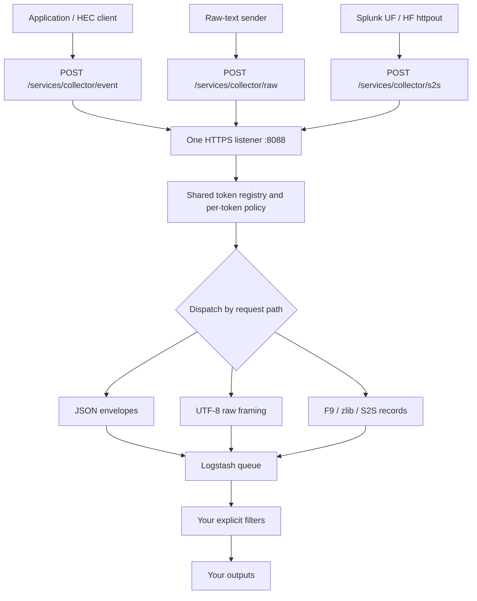

# Using HEC event, raw and S2S HTTP together

**One `splunk_hec` input serves all three ingestion formats concurrently on the
same HTTPS listener and forwards their native envelopes into the same Logstash
pipeline.** Configure the listener once, select the endpoint that matches each
sender's format, and apply your own transformations and destination routing later.

## 1. One listener, three payload decoders



### Endpoint contract

| Method | Exact path | Accepted body / purpose |
|---|---|---|
| POST | `/services/collector` | Event endpoint alias; JSON envelopes |
| POST | `/services/collector/event` | One envelope, concatenated envelopes, or an array of envelopes |
| POST | `/services/collector/event/1.0` | Same event decoder |
| POST | `/services/collector/raw` | UTF-8 text, framed within this request |
| POST | `/services/collector/raw/1.0` | Same raw decoder |
| POST | `/services/collector/s2s` | UF/HF binary S2S HTTP body |
| POST | `/services/collector/s2s/1.0` | Same S2S decoder |
| POST | `/services/collector/ack` | JSON `acks` list; token must have ACK enabled |
| POST | `/services/collector/ack/1.0` | Same ACK handler |
| GET | `/services/collector/health` | Current listener/admission health snapshot |
| GET | `/services/collector/health/1.0` | Same health handler |

Paths are case-sensitive and exact. Trailing slashes are not aliases. In
particular, `/services/collector/1.0` is not an event alias. Unknown paths return
404; wrong methods on known paths return 405, with the measured HEC error body.

**The URL selects the format.** `Content-Type` does not switch decoders. JSON sent
to `/raw` remains text, and ordinary JSON sent to `/s2s` is an invalid binary body.
Use the corresponding content types in clients so their intent is clear.

### What simultaneous support means

- All routes are registered by the same input; no endpoint-enable setting is needed.
- Requests on separate connections can be processed concurrently. The listener
  uses HTTP/1.1, handles one request per connection, and responds with
  `Connection: close`.
- Ingestion and ACK polling share admission slots, connection limits and accounted
  memory. They are not isolated worker pools per endpoint or per token.
- Default limits are 16 admitted requests and 64 connections. A busy S2S sender
  can therefore affect admission for event/raw clients and ACK polls.
- Per-request event order is retained by the insertion loop; events from concurrent
  requests can interleave. There is no global cross-sender ordering guarantee.

## 2. Configure the shared input once

Use [shared-listener.conf](../examples/shared-listener.conf) with
[hec-inputs.conf](../examples/hec-inputs.conf). Copy the policy to the path in the
pipeline, replace its token placeholders, and give the Logstash service a writable,
persistent state directory.

```logstash
input {
  splunk_hec {
    host => "0.0.0.0"
    port => 8088
    ssl_enabled => true
    inputs_conf => "/etc/logstash/hec-inputs.conf"
    state_directory => "/var/lib/logstash/hec-shared"
    ssl_self_signed_sans => "dns:localhost,dns:logs.example.test,ip:127.0.0.1,ip:::1"
  }
}
output { stdout { codec => json_lines } }
```

The example policy defines three tokens:

| Policy label | Intended use in these examples | ACK | Index policy |
|---|---|---|---|
| `forwarders` | UF/HF `[httpout]` | Off | No allowlist; wire indexes can include internal indexes |
| `applications` | Event and raw curl examples | Off | Default/allowed index `main` |
| `applications_ack` | Application ACK example | On | Default/allowed index `main` |

These labels do not bind tokens to URL paths. Any enabled token can authenticate
an ingestion endpoint when its index/channel requirements are met. Event and raw
clients can reuse the same token. Different tokens simply permit different policy.

The forwarder example intentionally does not restrict indexes to `main`: UF/HF
batches can also contain internal indexes. If you set an `indexes` allowlist,
include every index you intend to receive. A disallowed index in an S2S batch
causes validation failure before any events from that batch enter the queue.

### TLS and credentials

HTTPS is the default for every route on this input. Use a supplied PEM/keystore
identity as described in the [README](../README.md#tls), or let startup create a
self-signed identity under `state_directory/identity/`.

Configure the actual server DNS/IP SANs before generating that identity. Distribute
the public `server.crt` to clients as a trust certificate; keep the private store
and password in the server's state directory. The bind address `0.0.0.0` is not
the certificate hostname. Existing identities are reused, not silently replaced
when the SAN setting changes.

The requests below use these placeholders:

```bash
export HEC_URL='https://logs.example.test:8088'
export HEC_CA='/trusted/hec-server.crt'
export HEC_TOKEN='REPLACE_WITH_APPLICATION_TOKEN'
export HEC_ACK_TOKEN='REPLACE_WITH_ACK_TOKEN'
```

The main authentication form is `Authorization: Splunk <token>`. Basic auth also
accepts the token as the password. URL query-token authentication is disabled by
default and requires that specific token's `allowQueryStringAuth` permission.

Policy-file changes are checked every second and published as validated snapshots.
Publish complete files with an atomic rename. Invalid replacements retain the
last good policy. Listener/TLS configuration changes require the usual Logstash
pipeline restart/reload; token-file reload does not recreate the listener.

## 3. Send each format and understand the output

### Event: explicit JSON envelopes

```bash
curl --fail-with-body --cacert "$HEC_CA" \
  -H "Authorization: Splunk $HEC_TOKEN" \
  -H 'Content-Type: application/json' \
  "$HEC_URL/services/collector/event" \
  --data-binary '{"event":{"level":"INFO","text":"hello","latency_ms":0.1},"time":"1700000000.123456789","host":"app01","source":"application","sourcetype":"application_event","index":"main","fields":{"region":"test"}}'
```

Successful response with ACK off:

```json
{"text":"Success","code":0}
```

The native envelope retains the supplied `event` object, `time`, metadata and
indexed `fields`. Required Logstash internals are omitted in this illustration:

```json
{
  "event": {"level":"INFO","text":"hello","latency_ms":0.1},
  "time": "1700000000.123456789",
  "host": "app01",
  "source": "application",
  "sourcetype": "application_event",
  "index": "main",
  "fields": {"region":"test"}
}
```

- `event` can be a nonblank string, number, object or array. Root event values
  `true`, `false` and `null` are rejected, matching the captured oracle cases;
  booleans/nulls inside an object or array remain native values.
- One envelope produces one event. An embedded newline in its string does not
  invoke raw line breaking. Objects are not flattened or converted into strings.
- `fields` is a flat indexed-field map; nested indexed objects/lists are rejected.
  Nested application data belongs inside the `event` payload.
- String/numeric source `time` is preserved independently of internal `@timestamp`.
  The input does not extract timestamps from application text.
- There is no added top-level `message`, ECS enrichment or automatic JSON filter.
  A source-provided nested field named `message` remains part of its payload.

Both array and concatenated batching are supported:

```bash
# Array batch
curl --fail-with-body --cacert "$HEC_CA" \
  -H "Authorization: Splunk $HEC_TOKEN" \
  -H 'Content-Type: application/json' \
  "$HEC_URL/services/collector/event" \
  --data-binary '[{"event":"one"},{"event":"two"}]'

# Concatenated envelopes
curl --fail-with-body --cacert "$HEC_CA" \
  -H "Authorization: Splunk $HEC_TOKEN" \
  -H 'Content-Type: application/json' \
  "$HEC_URL/services/collector/event" \
  --data-binary '{"event":"one"}{"event":"two"}'
```

Each envelope has its own metadata; token defaults apply where supported metadata
is omitted. There is no batch-wide inheritance from the first envelope.

### Raw: text plus request metadata

```bash
curl --fail-with-body --cacert "$HEC_CA" \
  -H "Authorization: Splunk $HEC_TOKEN" \
  -H 'Content-Type: text/plain; charset=utf-8' \
  "$HEC_URL/services/collector/raw?host=raw01&source=manual-raw&sourcetype=manual_raw&index=main" \
  --data-binary $'first line\r\n\nsecond line\n  indented line\n{"level":"INFO"}\ntail'
```

This produces five envelopes with these `event` strings:

```text
first line
second line
  indented line
{"level":"INFO"}
tail
```

All five receive the request's `host`, `source`, `sourcetype` and `index`. In
particular, the JSON-looking line remains a string; it is not parsed as an object.

- LF and CRLF delimit records; empty records are not manufactured between
  consecutive delimiters. Nonempty whitespace-only records are preserved.
- Indentation is preserved, not interpreted as a multiline-continuation rule.
- A final unterminated line is emitted. State does not carry into another request.
  HTTP transport chunks are not event boundaries.
- Empty or delimiter-only raw bodies produce zero data events.
- UTF-8 validation and framing occur before insertion. Invalid raw encoding fails
  the request without silently adding replacement characters.
- Applied query metadata is `host`, `source`, `sourcetype` and `index`. Query
  `time`/`fields` values are not applied by this implementation; use an event
  envelope for explicit HEC source time and indexed fields.

For those four metadata names, precedence is event/wire value, request query,
token default, then global default. Raw has no event envelope, so its request
query is the highest available level. The final resolved index is checked against
the token's allowlist. Explicit null/invalid event metadata is validated rather
than automatically replaced with a default.

### S2S HTTP: native UF/HF `[httpout]`

Use the `forwarders` token from the example policy:

```ini
[httpout]
httpEventCollectorToken = REPLACE_WITH_FORWARDER_TOKEN
uri = https://logs.example.test:8088
batchSize = 65536
batchTimeout = 5
sslVerifyServerCert = true
sslVerifyServerName = true
```

Configure trust in the sender's `server.conf`:

```ini
[sslConfig]
sslRootCAPath = /etc/splunk/certs/hec-server-ca.pem
```

For a heavy forwarder forwarding without local indexing, also use:

```ini
[indexAndForward]
index = false
```

The configured URI is the base listener URL; the forwarder supplies the S2S path.
Use the appropriate sender restart/reload procedure after changing its settings.
See the checked-in [outputs.conf](../examples/outputs.conf) and
[server.conf](../examples/server.conf) examples.

The S2S decoder consumes binary records, not JSON or arbitrary raw text. It checks
the `F9` marker, inflates zlib, reads metadata/flags/typed fields, resolves raw
references/metric values, then produces native envelopes. Structured wire events
retain their boundaries; unstructured UF chunks use the documented line framing.
The complete batch is validated before queue insertion.

For exact bytes and bit masks, see [S2S wire format](s2s-wire-format.md). Classic
S2S TCP on port 9997 is not implemented; `httpout` uses this HTTPS listener.

## 4. Operate and route the shared input

### ACK-enabled application clients

The measured UF/HF 10.6.1.1 `httpout` requests did not supply a HEC request-channel
GUID. Keep `useACK=false` for those tokens. This is separate from classic forwarding
ACK protocols; a binary S2S metadata channel does not satisfy the HTTP GUID header.

For an application using the `applications_ack` token, every ingestion request
must supply a channel. The same token/channel must be used to poll its result:

Choose a distinct GUID per client; the value below is an illustrative channel.

```bash
export HEC_CHANNEL='12345678-1234-4234-8234-123456789abc'

ACK_RESPONSE=$(curl --fail-with-body --cacert "$HEC_CA" \
  -H "Authorization: Splunk $HEC_ACK_TOKEN" \
  -H "X-Splunk-Request-Channel: $HEC_CHANNEL" \
  -H 'Content-Type: application/json' \
  "$HEC_URL/services/collector/event" \
  --data-binary '{"event":"track this request"}')

# Use the actual returned ID; it is not guaranteed to restart at zero.
ACK_ID=$(python3 -c 'import json,sys; print(json.loads(sys.argv[1])["ackId"])' "$ACK_RESPONSE")

curl --fail-with-body --cacert "$HEC_CA" \
  -H "Authorization: Splunk $HEC_ACK_TOKEN" \
  -H "X-Splunk-Request-Channel: $HEC_CHANNEL" \
  -H 'Content-Type: application/json' \
  "$HEC_URL/services/collector/ack" \
  --data-binary "{\"acks\":[$ACK_ID]}"
```

An illustrative submission response is `{"text":"Success","code":0,"ackId":123}`;
its first completed poll returns `{"acks":{"123":true}}`. That true consumes the
status; a later poll for the same ID returns false. Unknown/pending IDs also return
false. A channel can alternatively be supplied as the `channel` query parameter.

**ACK true means queue acceptance.** It is not downstream completion, Splunk
replication or an unconditional disk-durability guarantee. Persistent-queue crash
durability depends on checkpoints/storage. After restart, old completion-cache
entries are unknown even if their events recover from the queue. See the
[delivery boundary](../README.md#ack-retry-and-delivery-boundary).

### Health, compression and backpressure

```bash
curl --fail-with-body --cacert "$HEC_CA" \
  "$HEC_URL/services/collector/health"
```

Healthy returns HTTP 200/code 17; unavailable admission capacity returns HTTP
503/code 18. The endpoint does not require a HEC token, though TLS/mTLS still
applies. It reports a capacity snapshot, not direct output health or a direct
measurement of queue fullness. Reserved memory keeps one bounded health path
available under ingestion-memory pressure; the configured connection cap still
applies.

Request gzip is decoded before the selected payload parser. S2S's internal zlib
layer remains required after any outer gzip. Chunked HTTP bodies and
`100-continue` are supported. A read/write deadline or exhausted connection budget
can close the transport, so clients must also handle incomplete responses.

| Condition | HTTP / HEC code |
|---|---|
| Accepted into queue | 200 / 0, optionally with numeric `ackId` |
| Missing token / malformed authorization | 401 / 2 or 3 |
| Disabled token / invalid token | 403 / 1 or 4 |
| Invalid data / incorrect allowed index | 400 / 6 or 7 |
| Missing / invalid ACK channel | 400 / 10 or 11 |
| Missing / blank event | 400 / 12 or 13 |
| ACK disabled / invalid indexed fields / query auth disabled | 400 / 14, 15 or 16 |
| Admission, allocation, ACK-capacity or queue failure | 503 / 9 |
| Health snapshot | 200 / 17 or 503 / 18 |

Event-batch validation can accept a valid prefix before returning a recorded HEC
error with `invalid-event-number`. Malformed S2S instead rejects the entire batch,
with zero source events and no synthetic replacement. A queue error after some
insertions can leave an accepted prefix for any format. Retrying can duplicate
accepted events, and a client timeout is not proof that nothing was queued.

### Routing without implicit payload transformation

Use preserved metadata such as `[source]`, `[sourcetype]` and `[index]` in your
own pipeline. S2S-derived events also have `[@metadata][splunk_hec][id]`. The input
does not add a generic endpoint-name field to event/raw envelopes. Chosen
sourcetypes are classification metadata, not an enforced proof of the URL used.

For example, replace the shared example's stdout output with this optional file
routing; create a writable destination directory for the Logstash service first:

```logstash
output {
  if [@metadata][splunk_hec][id] {
    file { path => "/var/log/logstash/hec/s2s.ndjson" codec => json_lines }
  } else if [sourcetype] == "application_event" {
    file { path => "/var/log/logstash/hec/event.ndjson" codec => json_lines }
  } else if [sourcetype] == "manual_raw" {
    file { path => "/var/log/logstash/hec/raw.ndjson" codec => json_lines }
  } else {
    file { path => "/var/log/logstash/hec/other.ndjson" codec => json_lines }
  }
}
```

This keeps native payloads while selecting destinations. Normal output encoding
omits `@metadata` after the routing conditions have used it. The preserved `[index]`
does not automatically select an Elasticsearch destination: that is an output
configuration decision. Add transformations for your destination schema explicitly.

### Evidence and implementation map

- [Current validation status](validation-status.md): final-candidate checks versus
  the blocked fresh live-sender qualification; do not infer a new live pass from
  these documentation examples.
- [Compatibility evidence](compatibility.md): real-oracle routes, responses and
  captured sender observations.
- [HecServer.java](../src/main/java/org/logstashplugins/hec/HecServer.java): shared
  listener, route selection, token/admission gates, ACK and queue response boundary.
- [HecProtocol.java](../src/main/java/org/logstashplugins/hec/HecProtocol.java):
  JSON envelopes, raw framing, metadata validation and native numeric values.
- [S2SDecoder.java](../src/main/java/org/logstashplugins/hec/S2SDecoder.java) and
  [S2SEvents.java](../src/main/java/org/logstashplugins/hec/S2SEvents.java): wire
  records and their native output interpretation.
