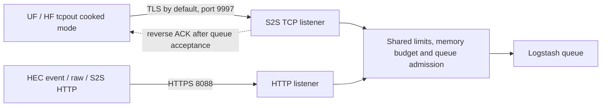

# Classic S2S TCP receiver (`tcpout` cooked mode)

All options are described in the [configuration reference](configuration.md); this page covers the wire protocol and delivery semantics.

The same `splunk_hec` input can optionally accept the classic Universal/Heavy
Forwarder `tcpout` stream on a second port. It is **disabled by default**. HTTP
`httpout`, HEC event and HEC raw stay on the HTTPS listener; this document covers
only the TCP listener.



## Status

Qualified, for the tested scope only: pinned **latest UF and HF 10.6.1.1**
(`b2ae2962645c`) sending cooked-mode `tcpout` directly to the packaged plugin on
Logstash 9.5.5 with a persistent queue. The evidence is
[`tcp-senders.json`](../tests/interop/evidence/tcp-senders.json): 16 real sender
runs (UF/HF x compressed on/off x `useACK` on/off x verified TLS/plaintext) plus a
receiver `SIGKILL` and restart while an ACK-enabled compressed TLS UF stayed
running. `python3 tests/tcp/check.py` exits 0 only when that evidence is complete
and names the exact gem in this directory.

This is not a claim of complete Splunk indexer or cluster equivalence. See
[Not supported](#not-supported).

## Enable it

```logstash
input {
  splunk_hec {
    host => "0.0.0.0"
    port => 8088
    state_directory => "/var/lib/logstash/hec-shared"
    ssl_self_signed_sans => "dns:localhost,dns:logs.example.test,ip:127.0.0.1,ip:::1"
    s2s_tcp_enabled => true
    s2s_tcp_port => 9997
    s2s_tcp_default_index => "main"
    # s2s_tcp_indexes => "main,application"   # empty means unrestricted
    # s2s_tcp_max_event_bytes => 0             # automatic: at least 8 MiB
  }
}
```

| Setting | Default | Meaning |
|---|---|---|
| `s2s_tcp_enabled` | false | Start the classic TCP listener |
| `s2s_tcp_port` | 9997 | Must differ from `port` |
| `s2s_tcp_default_index` | `main` | Index used when a record names none; must be allowed |
| `s2s_tcp_indexes` | empty | Comma-separated allowlist; a record for another index closes the connection without ACK |
| `s2s_tcp_max_event_bytes` | 0 (automatic) | Serialized logical-event cap for TCP. Automatic is the larger of `max_event_bytes` and `min(8 MiB, max_expanded_bytes)`; an explicit value may not exceed `max_expanded_bytes` |

TCP reuses the HTTP listener's bind address, **TLS identity and TLS options**,
aggregate memory budget, connection cap, ingestion slots, event-size cap, request
deadline and shutdown grace. A slow queue therefore applies back-pressure to both
listeners. `ssl_enabled => false` makes **both** listeners plaintext and is for
isolated tests only. `ssl_client_authentication => true` requires client
certificates on TCP as well.

A sender needs the same trust setup as for `httpout` (see
[`examples/outputs-tcp.conf`](../examples/outputs-tcp.conf)):

```ini
[tcpout]
defaultGroup = logstash

[tcpout:logstash]
server = logs.example.test:9997
sendCookedData = true
useACK = true
useSSL = true
sslVerifyServerCert = true
sslVerifyServerName = true
# The trust root is configured in server.conf [sslConfig] sslRootCAPath.
```

## Security model

* There is **no HEC token** in the classic protocol. Authorization is the network
  boundary plus TLS/mTLS. Use TLS verification on the sender and prefer
  `ssl_client_authentication` when the listener is reachable by untrusted hosts.
* The sender's `_guid` must have UUID shape. It namespaces event IDs and is
  **self-declared, not authenticated identity**.
* Token/password/secret-named ForwarderInfo entries are never copied into events.
* Peer IP, sender hostname, negotiated options and ForwarderInfo are exposed as
  connection provenance under `@metadata.splunk_hec.tcp` (not in the event body).

## Delivery semantics

* A record's events are inserted into the Logstash queue first; **then** the
  reverse acknowledgement for that record's ID is written. An ACK means "accepted
  into the Logstash queue", not output completion, Splunk replication, or
  unconditional fsync (PQ durability depends on your queue settings).
* A failed or interrupted insertion never produces an ACK; the connection is
  closed. A prefix of one record's events may already have been queued, so a
  resend can duplicate it.
* Event IDs (`@metadata.splunk_hec.id`) are computed from the same source
  coordinates as the HTTP S2S IDs, so a resend after reconnect receives the same
  ID. Distinct repeated lines keep distinct IDs; nothing is deduplicated by the
  input.
* With `useACK = false` the receiver sends no ACKs. Records with ID 0
  (heartbeats/ForwarderInfo-style control records) are never ACKed, matching the
  real receiver.
* A truncated record is not inserted and not ACKed.
* Each TCP record is fully read and size-checked before insertion. A record larger
  than the TCP cap is refused as a whole and closes the connection, so the sender
  retries it. The cap is higher than the HTTP `max_event_bytes` by default because
  real HF 10.6.1.1 senders emitted a ~1.2 MB internal introspection record
  (`splunk_intro_disk_objects`); refusing it would make the forwarder retry it
  forever and block everything queued behind it. If you set a smaller
  `s2s_tcp_max_event_bytes`, make sure no sender produces larger events.
* A **persistent queue rejects any single event larger than its `queue.page_capacity`**
  (default 64 MB; the old 1 MB value in small test configs is too small). The
  receiver then closes the connection without ACK and the forwarder retries the
  same record indefinitely, so keep the page capacity above the largest event
  (the TCP cap above) when forwarding heavy-forwarder internal logs.

## Event shape

Events use the same native envelope as S2S over HTTP (`event`, `time`, `host`,
`source`, `sourcetype`, `index`, `fields`) with no `message`, ECS or guessed
multiline handling. Per-record `MetaData:Host/Source/Sourcetype` values override
the channel defaults; `host::$decideOnStartup` falls back to the sender hostname
from the greeting. An indexed field literally named `host` stays inside `fields`.

TCP-specific provenance in `@metadata.splunk_hec.tcp`:

| Key | Meaning |
|---|---|
| `protocol` | `s2s-v4` |
| `sender_guid`, `sender_hostname`, `management_port`, `peer_ip` | Handshake identity (self-declared except `peer_ip`) |
| `compression_requested` | Sender capability string said `compression=1` |
| `stream_compressed` | The record stream actually used the compact zlib form |
| `ack_requested` | Sender capability string said `ack=1` |
| `forwarder_info` | Filtered ForwarderInfo key/value pairs |
| `event_id` | The sender's unsigned event/ACK ID when the record carried one |

## Observed wire facts

All derived from own captures of real latest senders against a real Splunk
receiver ([`tests/tcp/evidence`](../tests/tcp/evidence), raw streams in
[`tests/tcp/fixtures`](../tests/tcp/fixtures)) and checked by replay tests.

* The sender speaks first: a 400-byte greeting (`--splunk-cooked-mode-v3--`,
  hostname, management port, NUL padded). The receiver does not send a greeting.
* A capability frame (`ack=1;compression=0|1`) is answered by a control frame
  (`cap_response=success;...;v4=true;...`); then a ForwarderInfo frame
  (`_guid`, `__s2s_capabilities=v4=1;...`) follows.
* Frame integers are big-endian; the first records are opcodes `FF` (timezone),
  `FE`/`F8` (channel metadata), `FC` (event), `FD` (channel close).
* TCP event headers carry **independent** flag bits: `0x02` stream
  id/offset/suboffset, `0x04` event/ACK ID, `0x08` epoch seconds. This differs
  from the combined `flags & 0x0a` layout used by S2S over HTTP.
* **Retransmissions:** a record the sender resends after its acknowledgement wait
  expired carries an extra field-list entry, tag `46`: `U(marker) S("resent")`. It
  is kept as wire provenance (`s2s.wire_metadata.resent`), not as an indexed field.
  Date-part tags other than `42`/`4A` (and their sign variants) are refused in TCP
  streams instead of being guessed, because misreading a new tag shifts every later
  byte. Positionless records resent after a timeout may receive a new ID because
  their fallback identity covers the record bytes; source-coordinate IDs stay stable.
* Compression is one continuous `F9` + zlib stream with sync flushes, not a
  per-record compression. Reverse traffic stays plaintext: `FB U(id)`.
* **TLS connections:** latest UF and HF 10.6.1.1 were observed to send the
  compressed `F9` record stream even when their capability string said
  `compression=0`. Plaintext connections followed the capability. The receiver
  therefore decides from the stream: a leading `F9` is inflated, and a sender that
  *requested* compression but sent plain bytes is rejected.

## Not supported

* `sendCookedData = false` (uncooked) streams and legacy/older protocol levels
  (the receiver requires the compact `v4` negotiation).
* Heartbeats, token exchange, certificate requests, indexer discovery,
  load-balancing/cluster replication features, ACK range replies (`FA`), and
  channel counts above the advertised limit of 300.
* Splunk parsing-engine behavior. Timestamp/line-merge decisions already made by
  the sender are preserved; none are added.

## Reproduce

```sh
./gradlew test gem
docker compose -f docker/compose.yml run --rm interop --stage tcp
python3 tests/tcp/check.py
# Optional fresh wire capture against an owned real receiver:
docker compose -f docker/compose.yml run --rm --entrypoint python3 interop tests/tcp/run_capture.py
python3 tests/tcp/analyze.py
```

The first stage launches real pinned UF/HF containers (amd64, emulated on Apple
Silicon) and an owned Logstash container; everything it creates is removed on exit.
