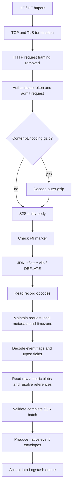

# S2S-over-HTTP: byte and bit-level decoder map

This describes the observed binary format implemented by this plugin's decoder,
ported from the pinned reference repository. It describes `/services/collector/s2s`
HTTP bodies, **not** the classic TCP/9997 handshake or framing. Unknown flag bits
are identified as unknown rather than assigned speculative meanings.

Notation: `U(x)` is an unsigned base-128 varint; `S(x)` is a length-prefixed UTF-8
string; `NS(x)` is its nullable form; `B(x)` is a length-prefixed byte blob.
Hexadecimal bytes are written `F9`, `FC`, etc. Byte offsets in the example are decimal.

## 1. Layers: what the decoder actually sees



The first `F9` below is **after HTTP framing and any outer gzip**, not an offset
in a TLS packet or TCP segment. Empty authenticated S2S probe bodies are accepted
as zero events without requiring an `F9` byte.

```text
Nonempty S2S entity:

offset 0              offset 1 onward
┌───────────────────┬──────────────────────────────────────────┐
│ F9 = 1111 1001     │ zlib-wrapped DEFLATE stream               │
│ S2S body marker   │ compresses the complete record sequence   │
└───────────────────┴──────────────────────────────────────────┘
                                       │ inflate
                                       ▼
┌──────────┬──────────────┬───────────┬───────────┬──────────────┐
│ timezone │ metadata #1  │ event #1  │ event #2  │ more records │
└──────────┴──────────────┴───────────┴───────────┴──────────────┘
```

### zlib and DEFLATE bits

A common zlib header is `78 9C`; other valid compression settings can produce
different header bytes. These are standard compression headers, not S2S fields.

```text
CMF = 78 = 0111 1000
           └──┘ └──┘
          CINFO  CM
             7   8 → DEFLATE
             └─────→ window = 2^(7+8) = 32768 bytes

FLG = 9C = 10 0 11100
           │  │   └── FCHECK: header divisibility check
           │  └────── FDICT = 0: no preset dictionary
           └───────── FLEVEL = 2: compression-level hint

Each DEFLATE block starts with bits read least-significant-bit first:

byte bit position:       2     1       0
                       ┌─────────┬────────┐
                       │ BTYPE   │ BFINAL │
                       └─────────┴────────┘
                         2 bits    1 bit

BTYPE 00 = stored/uncompressed block
      01 = fixed Huffman codes
      10 = dynamic Huffman codes
      11 = invalid/reserved
```

The JDK's `Inflater` handles DEFLATE's bit packing, Huffman codes and backreferences.
The S2S record parser operates on the resulting **bytes**, not on Huffman bits.

Forwarders commonly send a **sync-flushed, unfinished** zlib stream. Its ending
typically includes `00 00 FF FF`: the zero-length stored-block LEN/NLEN pair
after block alignment. That suffix is not an S2S event delimiter. `finished()`
can legitimately be false. The implementation accepts that bounded sync-flush
case, and also accepts a fully finished zlib stream, whose Adler-32 is checked
by `Inflater`. Dictionary-dependent or malformed streams are rejected.

## 2. Primitive encodings

### Unsigned varint: seven data bits per byte

```text
One encoded byte:

bit       7     6 5 4 3 2 1 0
       ┌─────┬───────────────┐
       │  C  │ payload bits  │
       └─────┴───────────────┘
        C=1 → another byte follows
        C=0 → final byte

value = (byte[0] & 7F)
      | (byte[1] & 7F) << 7
      | (byte[2] & 7F) << 14
      | ...
```

Low-order groups arrive first. This is unsigned LEB128-style encoding, not a
fixed-width integer and not ZigZag signed encoding.

```text
300 decimal = AC 02

AC = 1 | 0101100 → continue, payload 44
02 = 0 | 0000010 → finish,   payload 2

44 + (2 << 7) = 300
```

The reader supports up to ten bytes for uint64 values. Only one payload bit is
available in the tenth byte. Lengths and counts must also fit signed Java integer
bounds and the remaining input. Unsigned stream identifiers are retained even
when their high bit is set.

### Strings and blobs

```text
S(text)  = U(UTF-8 byte length)     + UTF-8 bytes
NS(text) = U(UTF-8 byte length + 1) + UTF-8 bytes
NS(null) = 00
B(data)  = U(byte length)          + bytes

                  null     empty string      "abc"
S                  —           00            03 61 62 63
NS                 00          01            04 61 62 63
```

Lengths and field-reference offsets count **bytes**, not characters. For example,
`é` is `C3 A9` in UTF-8 and consumes two bytes.

## 3. Record opcodes

After inflation, a record begins with one literal opcode byte. Opcodes are read
as bytes, not varints, even though their high bit is set.

| Opcode | Binary | Record |
|---|---|---|
| `FF` | `11111111` | Timezone: `S(serialized_timezone)` |
| `FE` | `11111110` | Metadata tuple |
| `F8` | `11111000` | Clone metadata variant: `U(1)` then the metadata tuple |
| `FC` | `11111100` | Event/control record |

There is no universal fixed-width record-length header. The parser advances by
the grammar of the selected opcode. A byte `FC` inside a length-delimited blob
or varint is not automatically another event.

### Metadata tuple

```text
FE
 │
 ├─ U(meta_id)
 ├─ NS("source::...")
 ├─ NS("host::...")
 ├─ NS("sourcetype::...")
 ├─ NS(s2s_channel)
 ├─ U(header_count)
 └─ S(header[0]) ... S(header[header_count-1])

F8 variant: F8 | U(1) | all the same fields above, starting with meta_id
```

The decoder removes the literal source/host/sourcetype prefixes and stores the
tuple in `meta_id → metadata`. Header names support indexed fields whose names
are referenced by a zero-based header index instead of repeated strings.

The metadata table and most recent timezone are **request-local**. Redefining a
metadata ID affects subsequent records. Referencing an unknown ID is invalid.
Timezone content is retained as opaque serialized text; it is not assumed to
always be a short name like `UTC`.

The tuple's S2S channel is distinct from the HTTP `X-Splunk-Request-Channel` GUID
used by HEC acknowledgment. The event index comes from an event metadata field
such as `_MetaData:Index`, not from a dedicated slot in this tuple.

## 4. Event layout and flag bits

```text
FC
 ├─ U(meta_id)
 ├─ U(flags)
 ├─ if (flags & 0A) != 0:
 │    ├─ U(stream_id)
 │    ├─ U(byte_offset)
 │    ├─ U(sequence)
 │    └─ U(epoch_seconds)
 ├─ U(field_count)
 ├─ field[0] ... field[field_count-1]
 └─ payload:
      ordinary event → B(raw)
      metric event   → B(metric_values) | B(raw)
```

Special case: `flags == 0 && field_count == 0` has **no raw-length byte and no raw
blob**. A simple marker can therefore be `FC 01 00 00`. Always reading a blob
length there would consume the next record incorrectly.

The implementation uses the following masks; it does not assign meanings to all
other bits:

| Mask | Bit | Decoder interpretation |
|---|---:|---|
| `00000002` | 1 | Participates in the `flags & 0A` time/stream-block test |
| `00000008` | 3 | Participates in the same test |
| `00000040` | 6 | Structured/already-parsed event |
| `00010000` | 16 | Metric-values blob precedes the raw blob |

Bits 1 and 3 are not independently labeled “time” and “stream”: the decoder only
knows that **either** makes the four-varint block present.

```text
Structured example: flags = 4A = 0100 1010

bit      7  6  5  4  3  2  1  0
value    0  1  0  0  1  0  1  0
            │        └─────┘
            │          time/stream block present
            └───────── structured

Raw UF example: flags = 023B = 0000 0010 0011 1011
    (flags & 40) == 0 → unstructured
    (flags & 0A) != 0 → time/stream block present
    other set bits retain their numeric value without guessed meanings

Metric/structured example: flags = 1004A
    bit 16 + bit 6 + bits 3/1
    its varint bytes are CA 80 04, not a fixed-width 00 01 00 4A
```

A record with no time/stream block, no raw data and no indexed fields is treated
as control-only. Such markers do not emit an event or consume the data-event cap.

## 5. Typed field tags: dispatch first, then unpack bits

Each field starts with a **varint tag**. After decoding that integer, the parser
uses this precedence:

```text
tag == 04                 → metadata key/value pair
(tag & C0) == 40          → date part
(tag & 01) != 0           → indexed value
otherwise                 → invalid/unsupported tag
```

### Metadata key/value

```text
U(04) | S(key) | S(value)

Example: 04 | S("_MetaData:Index") | S("main")
```

### Indexed-value bit fields

For a tag dispatched as an indexed value:

```text
decoded tag integer:

        higher attributes   bits 4 3 2     bit 1     bit 0
       ┌──────────────────┬─────────────┬──────────┬─────────┐
       │ other tag bits   │ value kind  │    N     │    1    │
       └──────────────────┴─────────────┴──────────┴─────────┘
                            (tag>>2)&7    │          indexed
                                         ├─ 1: S(inline field name)
                                         └─ 0: U(metadata header index)
```

| Kind | Inline-name tag | Following value |
|---:|---|---|
| 0 | `03` | `U(unsigned integer)` |
| 1 | `07` | `S(string)` |
| 2 | `0B` | `U(constant)`; 62=true, 61=false, 60=literal string `"null"` |
| 3 | `0F` | `U(raw byte offset)`, `U(byte length)` |
| 4 | `13` plus optional attributes | Metric-values byte offset; optional display digits/decimals |
| 6 | `1B` | Raw offset/length, then decode the slice as JSON-escaped string content |

Kinds 5 and 7 are unsupported by this decoder. Repeated keys become ordered
multivalues rather than silently replacing earlier values.

**Wire-byte continuation bits and decoded-tag attributes are different things.**
For example:

```text
wire tag: B3 03
          │  └─ final varint byte
          └──── continuation bit set

decoded tag = (B3 & 7F) | (03 << 7) = 01B3

kind              = (01B3 >> 2) & 7 = 4  → metric
inline name       = (01B3 & 02) != 0     → yes
format attributes = (01B3 & 0180) != 0   → read two more varints

U(tag) | S(metric name) | U(values offset) | U(digits) | U(decimals)
```

The current decoder consumes those display attributes without using them to
change the numeric measurement.

### Raw-reference resolution

Offsets cannot be resolved until the raw blob has been read:

```text
raw bytes:  s t a t u s = o k
byte index: 0 1 2 3 4 5 6 7 8
                          └─┬─┘
                 offset=7, length=2 → "ok"

0F | S("status") | U(7) | U(2)
           ↓ deferred reference
fields.status = raw[7:9] = "ok"
```

Bounds and UTF-8 boundaries are validated. Escaped references must also consume
their entire slice; trailing junk cannot be silently ignored.

## 6. Date parts and fractional seconds

```text
decoded date tag low byte:

bit       7 6       5            4 3 2 1 0
         ┌───┬───────────┬────────────────────┐
         │0 1│ negative? │ other value bits   │
         └───┴───────────┴────────────────────┘

U(tag) | U(part_id) | U(value)
```

Observed part IDs in the reference are 0=subsecond, 1=second, 2=minute, 3=hour,
4=year, 5=month, 6=day-of-month, 7=weekday, 8=zone. Do not assume every raw value is
a calendar number: some tag variants use shared constants. This implementation
retains the part/tag/value triples in provenance.

For subsecond part 0, leading decimal zeroes are encoded in the integer:

```text
z = trailing-zero bit count of v
digits = v >>> (z + 1)
fraction = "0" repeated z times, then decimal(digits)

Encoding: v = (digits << (z+1)) | (1 << z)

.407     → z=0, digits=407   → v=815   → varint AF 06
.007919  → z=2, digits=7919  → v=63356 → varint FC EE 03
```

For example, `40 00 AF 06` is date tag `40`, part `0`, value `815`:

```text
epoch_seconds = 1700000000
fraction      = 407
source time   = "1700000000.407"
```

This is reconstruction of supplied protocol time, not timestamp extraction from
log text. The timezone record does not replace the epoch-seconds value.

## 7. Metric values: IEEE-754 little endian

With the metric flag set, the first blob is the measurement buffer and the second
blob is raw text. Kind-4 offsets address the first; raw field references address
the second.

```text
field tags                         payload tail
┌────────────────────────┐         ┌──────────────────┬─────────────┐
│ metric cpu → offset 0  │ ──────→  │ B(metric_values) │ B(raw text) │
│ dimension → raw slice  │ ──────────────────────────→ │             │
└────────────────────────┘         └──────────────────┴─────────────┘

double logical bits:
63       62 ........ 52     51 ........................ 0
┌──────┬─────────────────┬──────────────────────────────┐
│ sign │ exponent (11)   │ fraction / mantissa (52)     │
└──────┴─────────────────┴──────────────────────────────┘

1.25 = 3FF4000000000000 (logical hexadecimal double)
wire = 00 00 00 00 00 00 F4 3F  (little-endian bytes)
```

`metric_name:cpu` becomes the measurement key `cpu`. Metric dimensions and repeated
indexed fields remain in `fields`; nonfinite measurements and out-of-bounds offsets
are rejected.

## 8. Complete annotated example

This is a synthetic teaching fixture, verified against the current compiled
decoder. Its sync-flushed HTTP entity is **100 bytes** and inflates to **101 bytes**.
It contains one timezone record, one metadata tuple and one structured event.

```text
Inflated offset   Meaning           Hexadecimal bytes
000               timezone          FF 03 55 54 43
005               metadata          FE 01
                                     0A 73 6F 75 72 63 65 3A 3A 73
                                     08 68 6F 73 74 3A 3A 68
                                     0F 73 6F 75 72 63 65 74 79 70 65 3A 3A 73 74
                                     02 63 00
043               event header      FC 01 4A 07 64 01 80 E2 CF AA 06 03
055               index metadata    04 0F 5F 4D 65 74 61 44 61 74 61 3A 49 6E 64 65 78
                                     04 6D 61 69 6E
077               subsecond         40 00 AF 06
081               indexed reference 0F 06 73 74 61 74 75 73 07 02
091               raw blob          09 73 74 61 74 75 73 3D 6F 6B
```

The event header expands as follows:

```text
FC          event opcode
01          metadata ID 1 → source=s, host=h, sourcetype=st, S2S channel=c
4A          structured + time/stream block
07          stream ID 7
64          offset 100
01          sequence 1
80 E2 CF
AA 06       epoch seconds 1700000000
03          three fields: index metadata, date part, indexed raw reference
```

Native output envelope, excluding Logstash internals/provenance for clarity:

```json
{
  "event": "status=ok",
  "time": "1700000000.407",
  "host": "h",
  "source": "s",
  "sourcetype": "st",
  "index": "main",
  "fields": {"status": "ok"}
}
```

The JSON above is the plugin's decoded representation; the S2S HTTP body itself is
binary, not that JSON. Structured records retain their event boundaries; raw UF
chunks are line-framed separately after record decoding.

## 9. Failure boundary and source map

The complete S2S body is inflated, decoded, references resolved and events validated
before queue insertion. Unknown opcodes/tags, missing metadata, truncated varints,
bad compression, invalid slices or malformed encoding fail the batch with HTTP
400/code 6 and no synthetic event. Capacity limits use busy HTTP 503/code 9. Successful
queue acceptance is not proof of downstream indexing; ACK semantics are documented
separately in the README.

| Implementation | Responsibility |
|---|---|
| [Compression.java](../src/main/java/org/logstashplugins/hec/Compression.java) | Outer gzip and F9/zlib handling |
| [S2SDecoder.java](../src/main/java/org/logstashplugins/hec/S2SDecoder.java) `Reader` | Varints, strings and bounded byte reads |
| `S2SDecoder.decode` | Record dispatch, metadata table, timezone state |
| `S2SDecoder.event` | Flags, field tags, two metric/raw blobs and reference resolution |
| `S2SDecoder.fraction` | Subsecond integer reconstruction |
| [S2SEvents.java](../src/main/java/org/logstashplugins/hec/S2SEvents.java) | Native envelopes, raw line framing and provenance |
| [HecServer.java](../src/main/java/org/logstashplugins/hec/HecServer.java) | Authentication, request lifecycle, queue acceptance and response |
